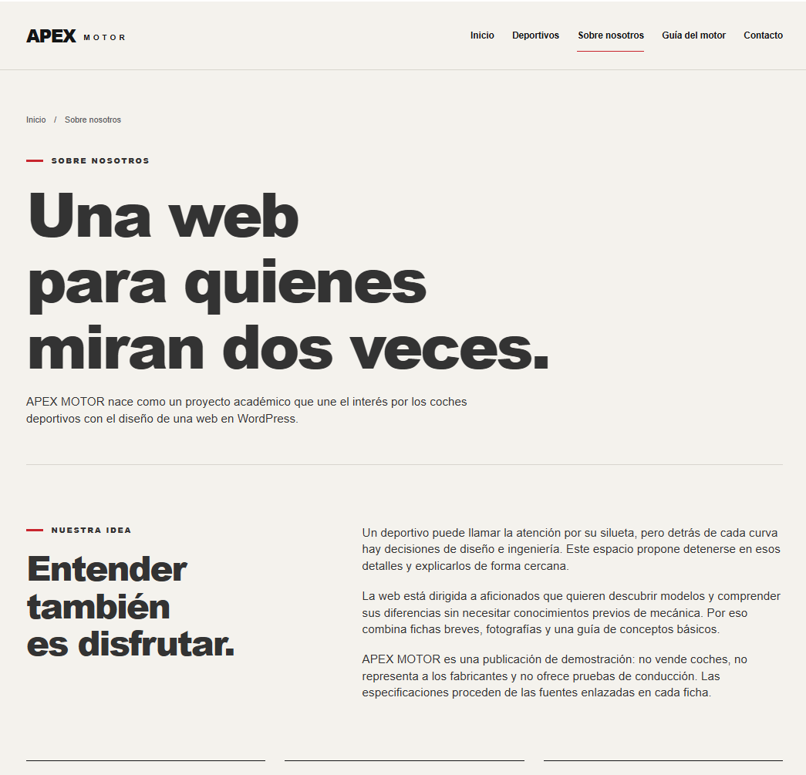
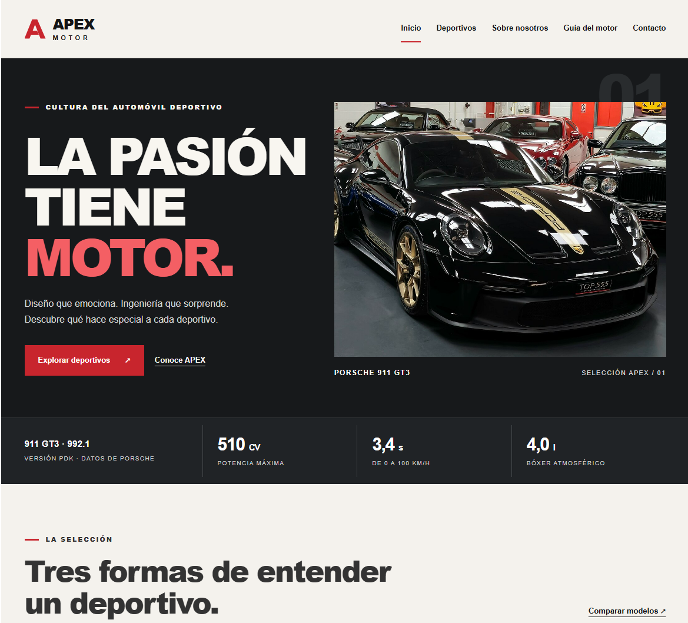
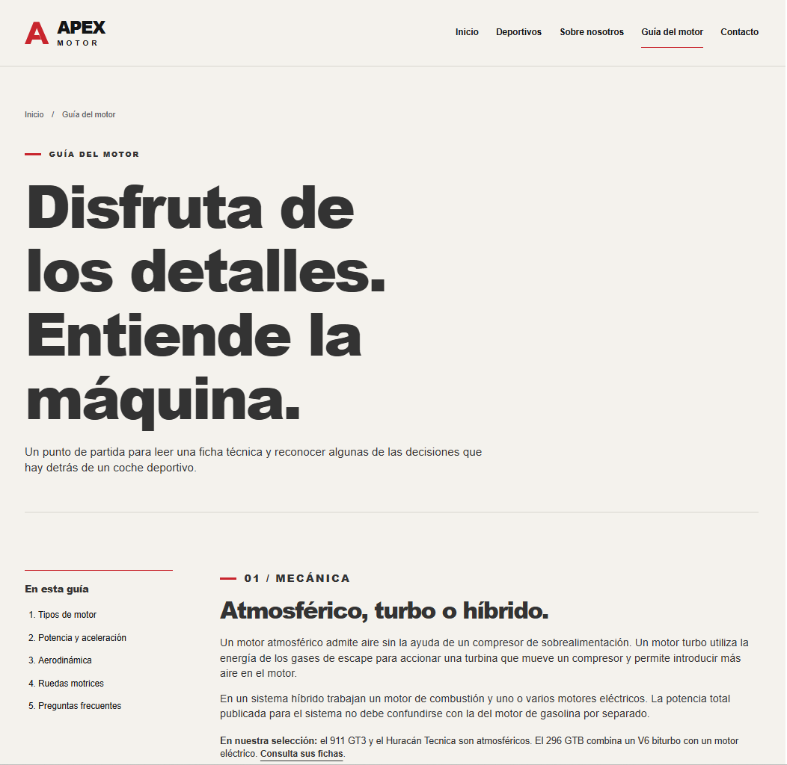
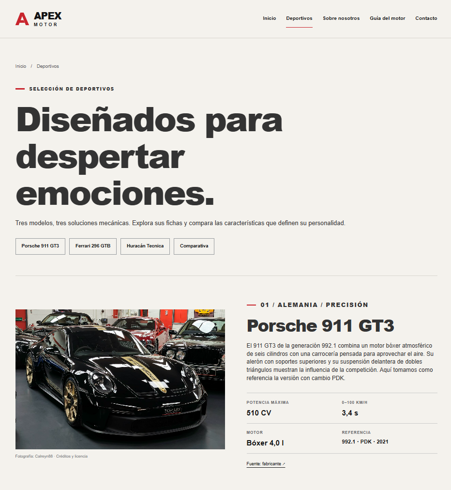
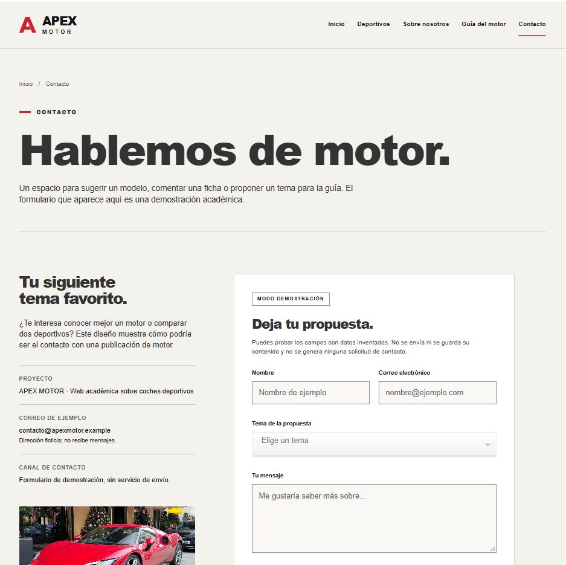

# APEX MOTOR

Proyecto académico desarrollado con WordPress para practicar la creación, configuración y personalización de un sitio web dentro de un entorno local de laboratorio.

APEX MOTOR es una web temática sobre coches deportivos que incluye fichas de vehículos, comparativas, contenido informativo sobre mecánica y un formulario de contacto de demostración.

## Objetivos del proyecto

- Instalar y configurar WordPress en un entorno local.
- Crear y organizar distintas páginas dentro del sitio web.
- Diseñar una navegación clara entre las diferentes secciones.
- Personalizar la apariencia de WordPress mediante HTML y CSS.
- Crear contenido estructurado sobre vehículos deportivos.
- Implementar un formulario de contacto de demostración.
- Aplicar buenas prácticas de seguridad antes de publicar la documentación en un repositorio público.

## Tecnologías utilizadas

- WordPress
- PHP
- MySQL / MariaDB
- HTML
- CSS
- XAMPP

## Capturas del proyecto

### Inicio

### Deportivos

### Sobre nosotros

### Guía del motor

### Contacto

